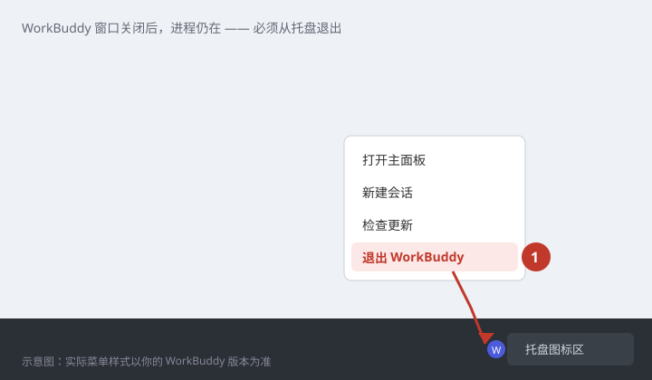
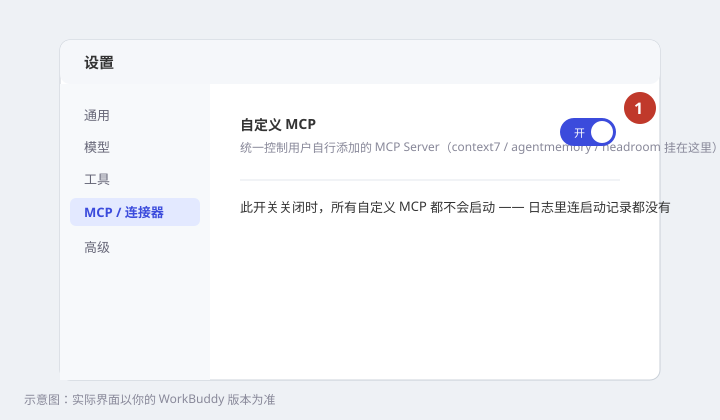
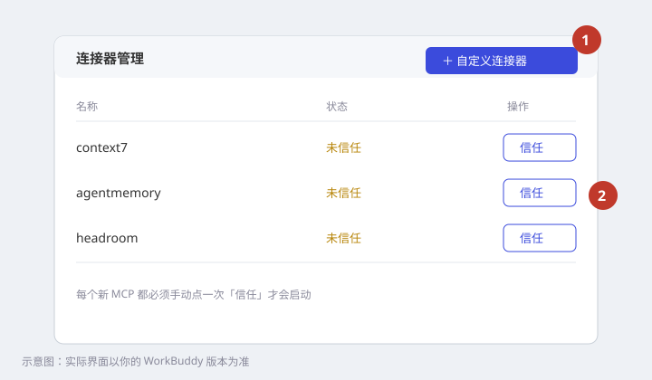
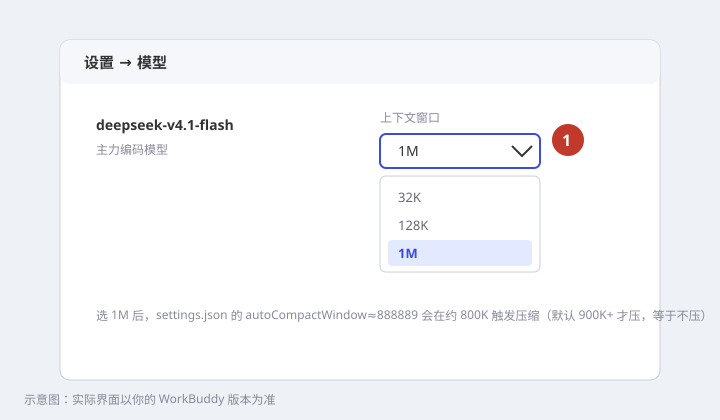
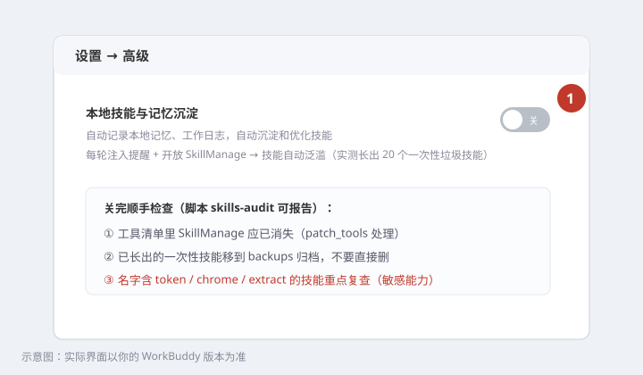

# WorkBuddy Harness：手动操作图文手册

自动化脚本管不了的界面操作全在这里。每步：目的 → 操作 → 预期 → 验证。
示意图按 WorkBuddy 5.7.x 画，实际界面可能略有出入，认文字和按钮名即可。

## 分工总览

| 环节 | 自动化（`python scripts/harness.py …`） | 手动（本手册） |
|---|---|---|
| 系统提示精简 | ✅ `install` / `post-update` | — |
| 工具清单精简 | ✅ 同上 | — |
| 规则/子代理/技能/hooks/记忆 | ✅ 同上 | — |
| MCP 配置写入 | ✅ `extras`（写 mcp.json） | **M2 开总开关、M3 点信任** |
| 上下文窗口 1M | ✅ settings.json 阈值 | **M4 下拉选 1M** |
| 技能沉淀开关 | 部分（工具清单） | **M5 关沉淀开关** |
| 退出 WorkBuddy | 脚本只做检测拒绝 | **M1 托盘退出** |
| 运行时验收 | `verify --runtime` 取证 | **M6 发验收任务** |
| 升级后恢复 | ✅ `post-update` 一键五连 | 升级后复查 M5 等是否被翻回 |

---

## M1 · 退出 WorkBuddy（所有写操作之前）

**目的**：运行中的 WorkBuddy 会把配置写回；脚本检测到进程会拒绝执行。

**操作**：右键任务栏托盘里的 WorkBuddy 图标 → **退出 WorkBuddy**。只关窗口不够。



**验证**：

```bash
python scripts/harness.py status
```

脚本不再提示 WorkBuddy running 即可。

---

## M2 · 打开「自定义 MCP」总开关

**目的**：此开关关闭时，mcp.json 里配的所有自定义 MCP（context7 / agentmemory / headroom）都不会启动，日志里连启动记录都没有。

**操作**：设置 → **MCP / 连接器** → 「自定义 MCP」拨到 **开**。



**预期**：开关常亮。此开关与 M3 的「信任」是两道闸，缺一不可。

---

## M3 · 逐个「信任」三个 MCP

**目的**：新加的 MCP 默认未信任 = 不启动。必须每个手动点一次。

**操作**：连接器管理 → 右上 **＋ 自定义连接器** → 找到 context7、agentmemory、headroom → 各点 **信任**。



**验证**（新开会话后）：问一句「用 context7 查 pytest.mark.parametrize 的 ids 参数」，能调起来即通。或者跑 `python scripts/harness.py verify --runtime` 看 trace。

---

## M4 · 模型上下文下拉选 1M

**目的**：settings.json 的 `autoCompactWindow≈888889` 以 1M 窗口为前提（约 800K 触发压缩）。窗口不选 1M，压缩阈值对不上。一次性设置。

**操作**：设置 → 模型 → deepseek-v4.1-flash → 上下文窗口下拉 → **1M**。



**验证**：改造前 prompt 中位 24.8 万 token、最大 87.4 万；到位后中位 5–6 万。

---

## M5 · 关「本地技能与记忆沉淀」

**目的**：默认开着，每轮注入 `<memory_and_skills_reminder>` 催模型存技能，并开放 SkillManage 让模型自己建技能。实测长出 20 个一次性垃圾技能，含敏感的 `chrome-localstorage-token-extract`。

**操作**：设置 → 高级 → 「本地技能与记忆沉淀」拨到 **关**。



**顺手做**：跑 `python scripts/harness.py skills-audit`，把报告里 `check-if-auto-sunk` / `SENSITIVE-NAME` 的技能**移**到 `harness-upgrade\backups\<日期>-auto-skills\` 归档（不要直接删）。

**验证**：新开会话跑点活，trace 里应无 `<memory_and_skills_reminder>`，工具清单里无 SkillManage。

**注意**：WorkBuddy 升级可能把这个开关翻回来——`post-update` 后复查。

---

## M6 · 发验收任务（运行时验收）

**目的**：一次任务同时检验流程、hook、子代理、提示注入、上下文占用。

**操作**：WorkBuddy 编码模式，工作区选空目录（如 `harness-selftest`），发送：

> 写一个 Python 模块 speed.py，函数 parse_speed(value: str) -> float | None：把 "12.5 Mbps"、"800 Kbps"、"#DIV/0!"、"" 转成 Mbps 数值，无效输入返回 None。写 pytest 测试覆盖这四种输入并运行。完成后让 code-reviewer 子代理审查，再汇报。

**逐项对照预期**：

| 观察点 | 预期 |
|---|---|
| 开头 | 先列任务清单 |
| 过程 | 写代码 → 每步跑测试并贴结果 |
| 子代理 | 调用了 code-reviewer |
| 汇报 | 有改动文件、验证命令、结果 |
| hook | 编辑后检查有运行（详见下） |

**收尾取证**（退出 WorkBuddy 后）：

```bash
python scripts/harness.py verify --runtime
```

三项应 PASS：hook 日志有记录、trace 含精简系统提示、请求含 rules 注入。实测基线：11 次模型调用约 98 秒，prompt 5–6 万 token。

---

## 升级后复查清单（`post-update` 跑完后 2 分钟）

WorkBuddy 自动升级实测会：补丁失效（post-update 已重打）、toneStyle 重置 professional（tune 已修）、停用插件复活（tune 已修）、**M2–M5 的界面开关可能被翻回**。

- [ ] M2 自定义 MCP 仍是「开」
- [ ] M3 三个 MCP 仍是「已信任」
- [ ] M4 仍是 1M
- [ ] M5 沉淀开关仍是「关」
- [ ] M6 验收任务跑一遍 + `verify --runtime`
